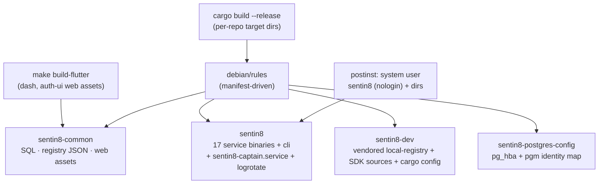
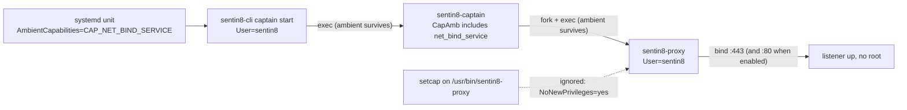

# sentin8-packaging - Detailed Design Document

> Wire-level construction of the Debian split. The overview lives in
> `README.md`; the operator/business framing in `BUSINESS.md`.

## 1. Scope & Context

The packaging repo is the **artifact-delivery plane**: it turns the
build outputs of the platform group (17 service binaries + cli + common
data + the vendored dev registry) into installable Debian packages, and
it DEFINES the file-system contract (FHS paths, system user, systemd
unit) every other repo's runtime assumptions assume.

Two packaging models exist by design:

- **Dev/source installs** - repo checkouts with per-repo `target/`
  binaries (the split's source-of-truth model; captain resolves
  binaries via `SENTIN8_CAPTAIN_BINARY_PREFIX` colon chains).
- **Deb installs** - FHS-fixed locations (`/usr/bin/`,
  `/usr/share/sentin8/`, `/etc/sentin8/`, `/var/{lib,log}/sentin8/`)
  driven by `manifest.yaml` (the single source of truth for the split).



## 2. Package Split (manifest.yaml = source of truth)

| Package | arch | Depends | Contents |
|---|---|---|---|
| `sentin8-common` | all | - | Platform SQL, `vertical-registry.json`, `catalog.json`, Flutter web assets (dash, auth-ui) |
| `sentin8` | any | `sentin8-common` | All service binaries, `/etc/sentin8/sentin8.env` template, `sentin8-captain.service`, logrotate |
| `sentin8-dev` | all | - | `sentin8-cli` binary, vendored crate local-registry, build-info crate source, SDK sources (consumed by vertical builds), cargo-config template |
| `sentin8-postgres-config` | all | `postgresql-18` | TLS-only `pg_hba.conf` + the `pgm` certificate-identity map |

FHS contract (manifest `fhs:` block): config `/etc/sentin8`, state
`/var/lib/sentin8`, logs `/var/log/sentin8`, run `/run/sentin8`, share
`/usr/share/sentin8`, TLS `/var/lib/sentin8/tls`, storage
`/var/lib/sentin8/storage`. System user `sentin8` (nologin).

## 3. Build & Delivery Mechanics

- `debian/rules` reads `manifest.yaml` and generates per-package
  `.install` files + control stanzas - the split is DATA, never
  hand-maintained install lists.
- `sentin8-dev`'s registry is produced by `cargo vendor` +
  `cargo local-registry` during the build (`build_produces:`), so
  verticals build offline against pinned versions.
- Sources gathered across the group: per-repo `target/release` binaries
  (the split layout - no single workspace target dir), Flutter builds
  from the app repos, registry JSONs from the groups.
- `sentin8-captain.service` is THE fleet unit: one supervisor per
  machine; per-service units do not exist (captain owns process
  lifecycle).

## 4. Machine Bring-up Contract (fleet plane, captain DESIGN §11.5)

The deb is what an OpenTofu module installs on a provisioned machine:

1. `sentin8` (+`sentin8-common` +`sentin8-postgres-config`) installs the
   binaries + FHS layout + the service unit.
2. The module materializes the operator env as
   `/etc/sentin8/sentin8.env` (the `sentin8_env_file` tofu variable).
3. The unit (or the docker image's `captain-start` entrypoint) sources
   the env file and starts captain against the shared Valkey registry.
4. Captain boots, reads the same env contract the operator gave the base
   machine, honors placement (`SENTIN8_CAPTAIN_EDGE_IP` when this is the
   edge), and joins the fleet - the registry is the only rendezvous.

### 4.1 Ingress bind privilege (PORTBIND-1)

The ingress is the only process on a fleet machine that binds a port
below 1024: `sentin8-proxy` holds `:443` (the L4/L7 ingress) and, when
external issuance is enabled, `:80` (the HTTP-01 challenge listener).
Both run as the unprivileged `sentin8` system user, so the listen needs
`CAP_NET_BIND_SERVICE` granted at process level.

**File capabilities are not the mechanism.** `setcap cap_net_bind_service=+ep`
on the binary cannot work in the packaged deployment:

1. The unit sets `NoNewPrivileges=yes`. Per `prctl(2)`, with
   `no_new_privs` set "file capabilities will not add to the permitted
   capability set" - the xattr is silently ignored at `execve`.
2. `ProtectSystem=full` makes `/usr` read-only at runtime, so the xattr
   could only be applied at install time, never by a service.
3. Each `dpkg` upgrade replaces the binary inode; xattrs do not survive
   replacement.

**The mechanism is ambient capabilities on the unit.** Captain spawns
its children with `fork`+`exec` (`catalog.rs`), and an ambient capability
survives `execve` of an unprivileged binary, so a capability granted to
captain's ambient set reaches the proxy child. The chain is
`sentin8-cli` → captain → proxy; every hop is unprivileged, so the
ambient set is preserved end to end.

```ini
[Service]
CapabilityBoundingSet=CAP_NET_BIND_SERVICE
AmbientCapabilities=CAP_NET_BIND_SERVICE
```

`CapabilityBoundingSet` is required, not optional: ambient capabilities
must also be within the bounding set. Narrowing the set to
`CAP_NET_BIND_SERVICE` alone reduces exposure relative to the unit's
previous unrestricted default, and ambient grants are compatible with
`NoNewPrivileges=yes` (they are not file capabilities and are not added
at `execve`). One declaration covers both listeners - the capability is
per-port-range, not per-port.



**Un-packaged (dev/source) installs use a host policy instead.** A
source checkout spawns through `SENTIN8_CAPTAIN_BINARY_PREFIX` or
`cargo run`; cargo writes a fresh inode per build, so no per-file xattr
survives, and a `cargo run` path cannot be pre-cap'd at all. The correct
dev mechanism is machine policy, which is inode-independent:

```bash
sudo sysctl -w net.ipv4.ip_unprivileged_port_start=80
# persist across reboots:
echo 'net.ipv4.ip_unprivileged_port_start=80' | sudo tee /etc/sysctl.d/99-sentin8-ingress.conf
```

`make ingress-port` performs exactly these two steps for the active
configuration (it derives the value from `.env` and is a no-op when the
host already allows the port). It stays an explicit target rather than an
implicit step of `make start`: a boot must not escalate privileges on its
own.

`80` is the value when the challenge listener is enabled (it binds
`:80`, so the floor must be `80`); a deployment with external issuance
disabled sets `443` instead. The kernel default is `1024` on most
distributions, so an un-configured dev host fails `TcpListener::bind` on
`:443` with `EACCES`.

**The appliance needs neither.** `core-appliance/Dockerfile` carries no
`USER` directive, so the container's captain and children start as root
and bind low ports directly; the published entry ports stay
`127.0.0.1:443` and `127.0.0.1:18000` (`docker-compose.core.yml`).

**The port itself is not operator-configurable by design.** The ingress
stays on `443`; discovery, the issuer, DPoP `htu`, cookies, and every
SDK URL builder derive scheme-default URLs, so a moved port silently
breaks OIDC discovery (proxy DESIGN §5 and §8 invariant 1). Access on
another port is a host-level mapping decision (NAT, `docker-compose`
publish, or the Windows `netsh portproxy`), never a change to the
listener.

The dev Makefile targets assert the precondition instead of surfacing a
bare `EACCES` at boot: a check refuses to start with the exact
`sysctl` remedy when `ip_unprivileged_port_start` is above the ingress
port.

## 5. Invariants

1. `manifest.yaml` is the single source of truth - install files and
   control stanzas are generated, never hand-edited.
2. No per-service systemd units; captain is the one unit.
3. The vendored registry pins reproduce the SDK tag the platform ships.
4. Secrets are never shipped - `/etc/sentin8/sentin8.env` is a template;
   real values land at provision time (module-owned).
5. FHS paths are declared once and consumed by every repo's runtime
   defaults.
6. **Low-port binding is a granted capability, never a root process and
   never a file xattr.** The unit grants
   `CAP_NET_BIND_SERVICE` (bounding set + ambient) so the unprivileged
   `sentin8` user holds `:443`/`:80`; `setcap` is inert under
   `NoNewPrivileges=yes` (§4.1).
7. **The ingress port is a protocol constant, not a knob.** `443` is the
   value every consumer's URL derivation assumes (§4.1); non-443 access
   is a host-level mapping decision.

## 6. Testing Strategy

- Lintian + `dpkg-deb --info` smoke on built debs.
- Install test in a container: postinst user/dir creation, service unit
  presence, `sentin8-cli` on PATH.
- **Ingress-bind assertion (PORTBIND-1)**: the unit's
  `CapabilityBoundingSet`/`AmbientCapabilities` carry
  `CAP_NET_BIND_SERVICE`, and an install test starts the unit as
  `User=sentin8` and asserts `sentin8-proxy` holds `:443` with
  `CapEff` containing `cap_net_bind_service` in `/proc/<pid>/status`.
  A `NoNewPrivileges=yes` + file-xattr combination is deliberately NOT
  tested - it is documented as inoperative (§4.1), not supported.
- Deliberately NOT tested here: actual service behavior (service repos'
  suites cover it).

## 7. Open Questions

- `sentin8-cli` currently installs inside `sentin8-dev`; an
  operator-plane move into `sentin8` (every host gets the CLI) tracks
  with the packaged install once deb paths are re-pointed at the
  split layout.
- RPM equivalence is deferred until a deployment targets it.

---

**Architecture & Design:** sentin8:packaging and its underlying concepts were designed by [Hamid Jahanzad](https://www.linkedin.com/in/hamidjahanzad/).
