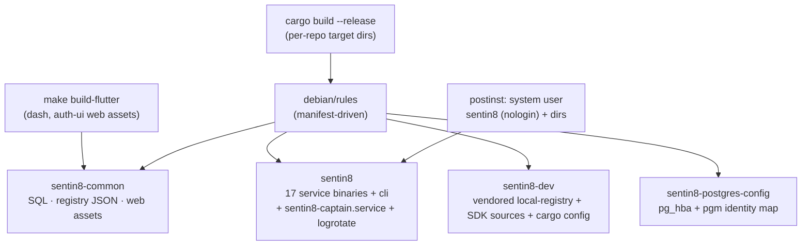

# sentin8-packaging - Detailed Design Document

> Wire-level construction of the Debian split. The overview lives in
> `README.md`; the operator/business framing in `BUSINESS.md`.

## 1. Scope & Context

The packaging repo is the **artifact-delivery plane**: it turns the
build outputs of the platform group (17 service binaries + cli + common
data + the vendored dev registry) into installable Debian packages, and
it DEFINES the file-system contract (FHS paths, system user, systemd
unit) every other repo's runtime assumptions assume.

Two packaging models exist by design:

- **Dev/source installs** - repo checkouts with per-repo `target/`
  binaries (the split's source-of-truth model; captain resolves
  binaries via `SENTIN8_CAPTAIN_BINARY_PREFIX` colon chains).
- **Deb installs** - FHS-fixed locations (`/usr/bin/`,
  `/usr/share/sentin8/`, `/etc/sentin8/`, `/var/{lib,log}/sentin8/`)
  driven by `manifest.yaml` (the single source of truth for the split).

## 2. Package Split (manifest.yaml = source of truth)

| Package | arch | Depends | Contents |
|---|---|---|---|
| `sentin8-common` | all | - | Platform SQL, `vertical-registry.json`, `catalog.json`, Flutter web assets (dash, auth-ui) |
| `sentin8` | any | `sentin8-common` | All service binaries, `/etc/sentin8/sentin8.env` template, `sentin8-captain.service`, logrotate |
| `sentin8-dev` | all | - | `sentin8-cli` binary, vendored crate local-registry, build-info crate source, SDK sources (consumed by vertical builds), cargo-config template |
| `sentin8-postgres-config` | all | `postgresql-18` | TLS-only `pg_hba.conf` + the `pgm` certificate-identity map |

FHS contract (manifest `fhs:` block): config `/etc/sentin8`, state
`/var/lib/sentin8`, logs `/var/log/sentin8`, run `/run/sentin8`, share
`/usr/share/sentin8`, TLS `/var/lib/sentin8/tls`, storage
`/var/lib/sentin8/storage`. System user `sentin8` (nologin).

## 3. Build & Delivery Mechanics

- `debian/rules` reads `manifest.yaml` and generates per-package
  `.install` files + control stanzas - the split is DATA, never
  hand-maintained install lists.
- `sentin8-dev`'s registry is produced by `cargo vendor` +
  `cargo local-registry` during the build (`build_produces:`), so
  verticals build offline against pinned versions.
- Sources gathered across the group: per-repo `target/release` binaries
  (the split layout - no single workspace target dir), Flutter builds
  from the app repos, registry JSONs from the groups.
- `sentin8-captain.service` is THE fleet unit: one supervisor per
  machine; per-service units do not exist (captain owns process
  lifecycle).

## 4. Machine Bring-up Contract (fleet plane, captain DESIGN §11.5)

The deb is what an OpenTofu module installs on a provisioned machine:

1. `sentin8` (+`sentin8-common` +`sentin8-postgres-config`) installs the
   binaries + FHS layout + the service unit.
2. The module materializes the operator env as
   `/etc/sentin8/sentin8.env` (the `sentin8_env_file` tofu variable).
3. The unit (or the docker image's `captain-start` entrypoint) sources
   the env file and starts captain against the shared Valkey registry.
4. Captain boots, reads the same env contract the operator gave the base
   machine, honors placement (`SENTIN8_CAPTAIN_EDGE_IP` when this is the
   edge), and joins the fleet - the registry is the only rendezvous.

## 5. Invariants

1. `manifest.yaml` is the single source of truth - install files and
   control stanzas are generated, never hand-edited.
2. No per-service systemd units; captain is the one unit.
3. The vendored registry pins reproduce the SDK tag the platform ships.
4. Secrets are never shipped - `/etc/sentin8/sentin8.env` is a template;
   real values land at provision time (module-owned).
5. FHS paths are declared once and consumed by every repo's runtime
   defaults.

## 6. Testing Strategy

- Lintian + `dpkg-deb --info` smoke on built debs.
- Install test in a container: postinst user/dir creation, service unit
  presence, `sentin8-cli` on PATH.
- Deliberately NOT tested here: actual service behavior (service repos'
  suites cover it).

## 7. Open Questions

- `sentin8-cli` currently installs inside `sentin8-dev`; an
  operator-plane move into `sentin8` (every host gets the CLI) tracks
  with the packaging backlog (SD-7) once deb paths are re-pointed at the
  split layout.
- RPM equivalence is deferred until a deployment targets it.

---

**Architecture & Design:** sentin8:packaging and its underlying concepts were designed by [Hamid Jahanzad](https://www.linkedin.com/in/hamidjahanzad/).
